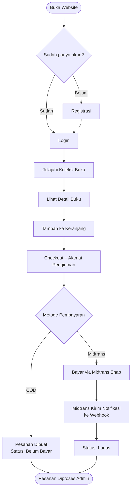
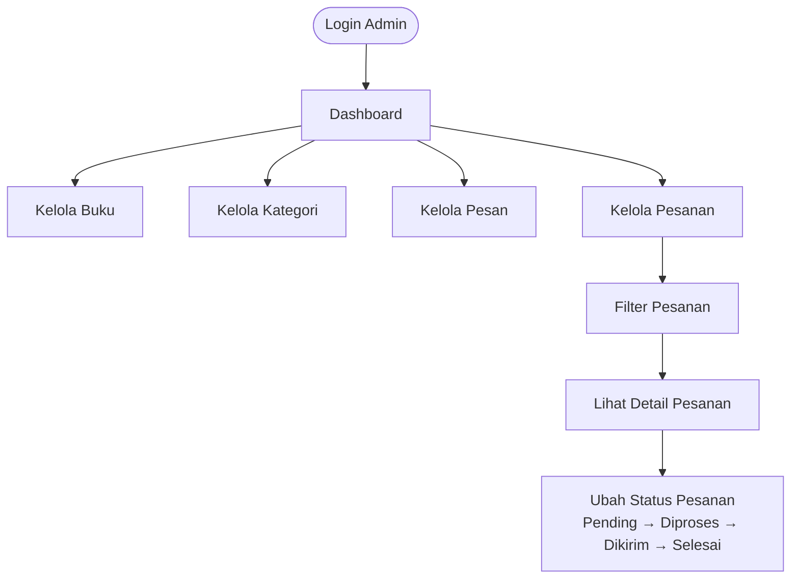
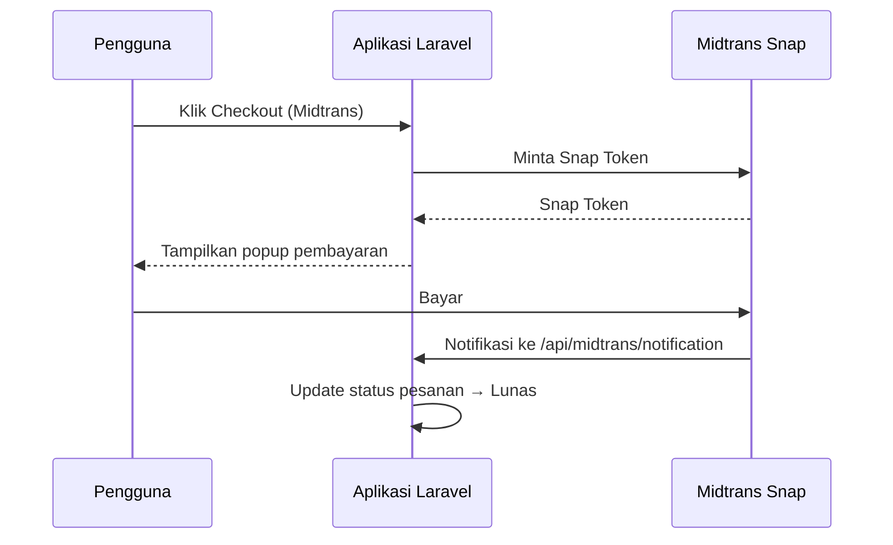

# 📚 Book Store Arjuanda

Aplikasi toko buku online berbasis web yang dibuat dengan **Laravel** sebagai proyek Uji Kompetensi (BNSP). Pengguna dapat menjelajahi koleksi buku, berbelanja lewat keranjang, dan membayar dengan **COD** atau **Midtrans**. Admin mengelola buku, kategori, pesan, dan pesanan lewat dashboard.

## ✨ Fitur

### Pengguna
- Registrasi, login, dan logout
- Edit profil beserta foto avatar
- Melihat koleksi buku dan detail buku
- Keranjang belanja
- Checkout dengan alamat pengiriman
- Pembayaran **COD** atau **Midtrans (Snap)**
- Riwayat dan detail pesanan
- Mengirim pesan ke admin dan melihat riwayat balasan

### Admin
- Dashboard ringkasan (total buku, kategori, user, pesan masuk)
- Kelola buku (tambah, ubah, hapus)
- Kelola kategori
- Membaca dan membalas pesan pengguna
- Kelola pesanan masuk: lihat status pembayaran (**Lunas / Belum Bayar / Gagal**), filter pesanan, dan ubah status pesanan (Pending, Diproses, Dikirim, Selesai, Dibatalkan)
- Status **Lunas** otomatis terisi saat pembayaran Midtrans berhasil (lewat webhook)

## 🔄 Alur Aplikasi

### Alur Pengguna



### Alur Admin



### Alur Pembayaran Midtrans



## 🛠️ Teknologi

| Bagian | Teknologi |
|---|---|
| Framework | Laravel 12, PHP 8.2 |
| Database | MySQL |
| Tampilan | Blade, Bootstrap 5, Font Awesome |
| Pembayaran | Midtrans Snap (Sandbox) |
| Server lokal | XAMPP, `php artisan serve` |

## 📋 Kebutuhan

- PHP 8.2 atau lebih baru
- Composer
- MySQL (XAMPP)
- Akun [Midtrans Sandbox](https://dashboard.sandbox.midtrans.com)

## 🚀 Cara Menjalankan

1. Clone repository:
   ```bash
   git clone https://github.com/adenniansyah/Projek_BNSP.git
   cd Projek_BNSP
   ```
2. Pasang dependensi:
   ```bash
   composer install
   ```
3. Salin file environment dan buat app key:
   ```bash
   copy .env.example .env
   php artisan key:generate
   ```
4. Buat database `bookstore_arjuanda` di phpMyAdmin, lalu atur `.env`:
   ```env
   DB_CONNECTION=mysql
   DB_HOST=127.0.0.1
   DB_PORT=3306
   DB_DATABASE=bookstore_arjuanda
   DB_USERNAME=root
   DB_PASSWORD=
   ```
5. Isi key Midtrans di `.env` (ambil dari Dashboard Sandbox → Pengaturan → Kunci Akses → **Kunci Server**):
   ```env
   MIDTRANS_SERVER_KEY=isi_server_key_sandbox
   MIDTRANS_CLIENT_KEY=isi_client_key_sandbox
   MIDTRANS_IS_PRODUCTION=false
   ```
6. Jalankan migrasi dan hubungkan storage:
   ```bash
   php artisan migrate
   php artisan storage:link
   ```
7. Jalankan server:
   ```bash
   php artisan serve
   ```
   Buka `http://127.0.0.1:8000`.

## 💳 Pembayaran Midtrans

- Metode **Midtrans** memakai Snap dengan Sandbox. Kartu uji: `4811 1111 1111 1114`, CVV `123`, OTP `112233`.
- Status **Lunas** diperbarui lewat webhook. Atur *Payment Notification URL* di dashboard Midtrans ke:
  ```
  https://<url-ngrok-kamu>/api/midtrans/notification
  ```
  Saat pengembangan lokal, jalankan `ngrok http 8000` agar webhook bisa menjangkau laptop.
- Token pembayaran memiliki masa berlaku. Jika kedaluwarsa, buat pesanan baru atau buka ulang halaman pembayaran.

## 🔑 Akun Admin

Akun admin dibuat dengan mengubah kolom `role` pada tabel `users` menjadi `admin`
(atau lewat seeder jika tersedia). Akun biasa memiliki `role = user`.

## 📁 Struktur Penting

```
app/Http/Controllers   → logika (OrderController, BookController, dll.)
app/Services           → MidtransService
config/midtrans.php    → konfigurasi Midtrans
resources/views        → tampilan Blade (user, admin, layouts)
routes/web.php         → rute aplikasi
database/migrations    → struktur tabel
```

## 👤 Pembuat

**Arjuanda Denniansyah**: Mahasiswa Teknik Informatika, Universitas Muhammadiyah Jakarta
GitHub: [@adenniansyah](https://github.com/adenniansyah)
